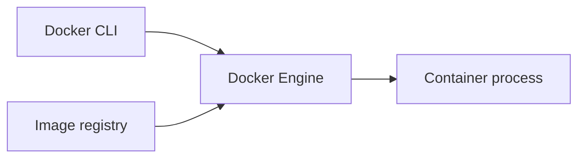

# Introduction to Docker

Explain containers and verify a first disposable workload.

> [!info] Example status
> Written with official references; no Docker commands, installations, workflows, registry changes, or deployments were executed for this vault. Expected results are predictions, not captured test evidence. Version tags are readable learning defaults and can move; use reviewed digests for release inputs.

## Learning objectives

Explain containers and verify a first disposable workload. You will also identify the relevant configuration, recognize failure conditions, and complete a small practice task.

## Questions answered

- What does Docker solve, and how do I run my first container?

## Prerequisites

Examples target Ubuntu Linux with Bash, Docker Engine, and the Docker Compose v2 plugin (`docker compose`). An internet connection and permission to use the selected practice environment are needed for downloads or remote operations. Windows users should use an appropriately configured WSL2 Ubuntu shell for these Bash examples; they are not PowerShell commands. macOS users need Docker Desktop or another Linux Engine and must adapt Linux-only UID/path behavior.

No earlier lesson is required. Read [[Docker/Docker Index|the Docker path]] for orientation.

## Introduction, purpose, and how it works

A container is an isolated process with its own filesystem view and network settings. An image supplies its starting files. Docker Engine accepts requests from the Docker command-line client and starts those processes. This reduces differences between developer machines: the same image supplies the same user-space tools.

A virtual machine boots a guest kernel; Linux containers share a Linux kernel. On macOS and Windows, Docker Desktop normally provides a Linux VM underneath Linux containers. Containers do not automatically make arbitrary code safe.

## Syntax and configuration

| Keyword or syntax | Definition and purpose | When to use it and common mistakes |
| --- | --- | --- |
| `docker run --rm IMAGE` | Create and start a disposable container | Use for one-off tasks; it does not remove the image. |
| `docker version` | Inspect client and server versions | Use before diagnosing Engine connectivity; a client version alone is insufficient. |

The practical example below shows these concepts in context; do not run an isolated reference row without its stated prerequisites.

## Practical example

**Execution context:** Local development or reading exercise. The walkthrough identifies filenames and the machine where each operation belongs.

```bash
docker version
docker compose version
docker run --rm hello-world
```



## Step-by-step walkthrough

1. On Ubuntu Linux, open Bash. If Docker is missing, follow the linked official Ubuntu installation guide; installation is a separate administrator decision. Docker-group membership grants powerful host access.

2. Run `docker version`: a client and server section confirm that the CLI can reach the Engine. Record the versions for your own lab.

3. Run `docker compose version`: these notes use the Compose v2 plugin command, with a space, rather than legacy `docker-compose`.

4. Run the final command. Docker downloads the image if needed, starts its default process, and removes the exited container because of `--rm`. Internet access is needed for the first pull.

## Expected result

A greeting explains that Docker started a process. This is expected output, not output captured while writing this vault.

## Practice

Run the greeting a second time and explain why the image need not download again. Success: you can distinguish image download from container creation.

## Common errors and troubleshooting

“Cannot connect to the Docker daemon”: start the intended Engine and check the Docker context. “Permission denied” on the socket: follow the official access setup; do not make the socket world-writable.

## Knowledge check

1. What is isolated?
2. Does a container boot a guest kernel?
3. What does the CLI contact?
4. Why does the second run often start faster?
5. Did these notes install Docker?

> [!question]- Answers
> 1. A process and its views of files, networks, and other resources.
> 2. A Linux container shares the host Linux kernel.
> 3. The Docker Engine API.
> 4. The image is cached locally.
> 5. No; the examples were not executed.

## Cleanup

The container removes itself. The small image remains cached; keeping it is harmless.

## Related lessons

- [[00 - Learning Roadmap|Full learning checklist]]
- [[Docker/Docker Index|Docker learning path]]
- [[Docker/Docker Questions|Docker questions]]
- [[01 - Docker Fundamentals/02 - Images and Containers|Next in the roadmap: Images and Containers]]

## Official references

- [Docker official documentation](https://docs.docker.com/get-started/)
- [Ubuntu official documentation](https://docs.docker.com/engine/install/ubuntu/)

---

## 📚 Lesson Navigation

| ⬅️ Previous Lesson | Next Lesson ➡️ |
|:------------------|----------------:|
| [[00 - Learning Roadmap\|Learning Roadmap]] | [[01 - Docker Fundamentals/02 - Images and Containers\|Images and Containers]] |

🏠 [[00 - Learning Roadmap|Back to Learning Roadmap]]
