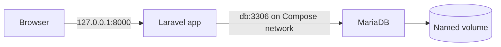

# Laravel and MariaDB Networking

Trace a Laravel database connection through Compose DNS.

> [!info] Example status
> Written with official references; no Docker commands, installations, workflows, registry changes, or deployments were executed for this vault. Expected results are predictions, not captured test evidence. Version tags are readable learning defaults and can move; use reviewed digests for release inputs.

## Learning objectives

Trace a Laravel database connection through Compose DNS. You will also identify the relevant configuration, recognize failure conditions, and complete a small practice task.

## Questions answered

- Why must Laravel use DB_HOST=db instead of localhost?

## Prerequisites

Examples target Ubuntu Linux with Bash, Docker Engine, and the Docker Compose v2 plugin (`docker compose`). PHP examples use PHP 8.4; frontend examples use Node 22; database examples use MariaDB 11.4. Check the project’s own support constraints. An internet connection and permission to use the selected practice environment are needed for downloads or remote operations. Windows users should use an appropriately configured WSL2 Ubuntu shell for these Bash examples; they are not PowerShell commands. macOS users need Docker Desktop or another Linux Engine and must adapt Linux-only UID/path behavior.

Earlier lessons: [[02 - Docker Development/01 - Laravel Docker Environment|Laravel Docker Environment]], [[02 - Docker Development/03 - MariaDB Container|MariaDB Container]].

## Introduction, purpose, and how it works

Each container has its own loopback interface. From PHP, localhost points to PHP’s container. Compose creates a default network with DNS records for service keys, so db points at the MariaDB container. DB_PORT is the database’s internal port, regardless of any host publishing. A browser cannot resolve Compose-only names; only the backend uses db.

## Syntax and configuration

| Keyword or syntax | Definition and purpose | When to use it and common mistakes |
| --- | --- | --- |
| `DB_HOST=db` | Select the Compose database service | Use inside the app container; the host cannot normally resolve this name. |
| `depends_on condition: service_healthy` | Wait for a declared readiness check | Use for startup sequencing; applications still need reconnect handling. |

The practical example below shows these concepts in context; do not run an isolated reference row without its stated prerequisites.

## Practical example

**Execution context:** Local development or reading exercise. The walkthrough identifies filenames and the machine where each operation belongs.

```bash
docker compose up -d --wait
docker compose exec app php artisan config:clear
docker compose exec app php artisan migrate:status
docker compose exec app php -r 'echo gethostbyname("db"), PHP_EOL;'
```



## Step-by-step walkthrough

1. Use the complete two-service Compose file from Laravel Docker Environment. Its app environment already sets DB_HOST=db, DB_PORT=3306, and matching database credentials.

2. Wait for the database health check; a started process is not necessarily ready to accept SQL.

3. Clear Laravel’s cached configuration in this local lab so changed environment values are read. Do not blindly clear production caches as a networking fix.

4. Read migration status to test an application-level connection. A “migration table not found” response can mean authentication succeeded but schema initialization is still needed.

5. Resolve db using PHP to separate DNS diagnostics from authentication diagnostics.

## Expected result

PHP resolves db to a private container IP and migration status can query the database after the earlier migration step.

## Practice

Set DB_HOST to an invalid name temporarily, reproduce the DNS failure, then restore it. Success: recognize DNS versus SQL authentication errors.

## Common errors and troubleshooting

Connection refused: inspect health and internal port. Access denied: inspect account/database grants and initialized credentials. SQLSTATE unknown host: check shared networks and service key.

## Knowledge check

1. What does localhost mean in app?
2. What resolves db?
3. Should DB_PORT use a host mapped port?
4. Why clear local config cache?
5. Does the browser contact db?

> [!question]- Answers
> 1. The app container.
> 2. Compose network DNS.
> 3. No.
> 4. To reread environment values.
> 5. No, Laravel does.

## Cleanup

Restore any changed environment values and run docker compose down when finished. Keep the lab volume unless intentionally resetting it.

## Related lessons

- [[00 - Learning Roadmap|Full learning checklist]]
- [[Docker/Docker Index|Docker learning path]]
- [[Docker/Docker Questions|Docker questions]]
- [[02 - Docker Development/01 - Laravel Docker Environment|Laravel Docker Environment]]
- [[02 - Docker Development/03 - MariaDB Container|MariaDB Container]]
- [[02 - Docker Development/05 - Environment Variables|Next in the roadmap: Environment Variables]]

## Official references

- [Network official documentation](https://docs.docker.com/engine/network/)
- [Health official documentation](https://docs.docker.com/compose/how-tos/startup-order/)
- [Laravel official documentation](https://laravel.com/docs/13.x/deployment)

---

## 📚 Lesson Navigation

| ⬅️ Previous Lesson | Next Lesson ➡️ |
|:------------------|----------------:|
| [[02 - Docker Development/03 - MariaDB Container\|MariaDB Container]] | [[02 - Docker Development/05 - Environment Variables\|Environment Variables]] |

🏠 [[00 - Learning Roadmap|Back to Learning Roadmap]]
