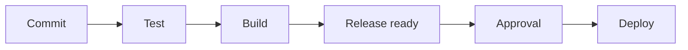

# Introduction to CI CD

Explain the pipeline stages and run a harmless first workflow in a practice repository.

> [!info] Example status
> Written with official references; no Docker commands, installations, workflows, registry changes, or deployments were executed for this vault. Expected results are predictions, not captured test evidence. Version tags are readable learning defaults and can move; use reviewed digests for release inputs.

## Learning objectives

Explain the pipeline stages and run a harmless first workflow in a practice repository. You will also identify the relevant configuration, recognize failure conditions, and complete a small practice task.

## Questions answered

- What is the difference between CI, continuous delivery, and continuous deployment?

## Prerequisites

Workflow examples target GitHub Actions on `ubuntu-24.04`; shell commands use Bash unless explicitly executed with `sh`. An internet connection and permission to use the selected practice environment are needed for downloads or remote operations. Windows users should use an appropriately configured WSL2 Ubuntu shell for these Bash examples; they are not PowerShell commands. macOS users need Docker Desktop or another Linux Engine and must adapt Linux-only UID/path behavior.

No earlier lesson is required. Read [[GitHub Actions/GitHub Actions Index|the Actions path]] for orientation.

## Introduction, purpose, and how it works

Continuous integration (CI) checks changes frequently through automated builds and tests. Continuous delivery keeps tested releases ready for a human deployment decision. Continuous deployment automatically releases changes that meet policy. GitHub Actions is an event-driven automation service: an event creates a workflow run, jobs are assigned to runners, and each runner executes steps. A green greeting job proves automation works, not that an application is correct.

## Syntax and configuration

| Keyword or syntax | Definition and purpose | When to use it and common mistakes |
| --- | --- | --- |
| `on: workflow_dispatch` | Allow a manual run | Use for learning or controlled operations; the workflow must be available on the default branch. |
| `runs-on: ubuntu-24.04` | Select a hosted runner image | Use for Linux jobs; runner images receive updates. |

The practical example below shows these concepts in context; do not run an isolated reference row without its stated prerequisites.

## Practical example

**Execution context:** CI demonstration in a practice repository. The walkthrough identifies filenames and the machine where each operation belongs.

```yaml
name: Learning example
on:
  workflow_dispatch:
permissions:
  contents: read
jobs:
  greeting:
    runs-on: ubuntu-24.04
    steps:
      - run: printf "CI runner is ready\n"
```



## Step-by-step walkthrough

1. Use a practice GitHub repository with Actions enabled and permission to add workflow files. Hosted runner usage can consume your account allowance or incur charges; check your plan before running examples.

2. The workflow would live at .github/workflows/hello.yml. This vault stores it only as a Markdown example. If you later choose to try it, commit the file on the default branch.

3. Open the repository Actions tab and select Learning example, then Run workflow. workflow_dispatch is the manual trigger.

4. Expand the greeting job and its run step. The runner executes the Bash printf command; no checkout or deployment is needed.

## Expected result

A log line reads CI runner is ready and the job succeeds if GitHub accepts and executes it.

## Practice

Change the greeting in a practice repository and run it again. Success: locate the new run’s commit SHA and log.

## Common errors and troubleshooting

No Run workflow button: confirm workflow_dispatch exists on the default branch and you have access. Queued jobs: inspect runner availability and account limits.

## Knowledge check

1. What does CI validate?
2. Does delivery require automatic deployment?
3. What executes a job?
4. What starts this workflow?
5. Does a greeting validate Laravel?

> [!question]- Answers
> 1. Frequent changes using automated checks.
> 2. No.
> 3. A runner.
> 4. A manual dispatch.
> 5. No.

## Cleanup

No external services are created. A practice workflow can be disabled from Actions; retain logs only as needed and avoid storing secrets in them.

## Related lessons

- [[00 - Learning Roadmap|Full learning checklist]]
- [[GitHub Actions/GitHub Actions Index|GitHub Actions learning path]]
- [[GitHub Actions/GitHub Actions Questions|GitHub Actions questions]]
- [[03 - GitHub Actions Fundamentals/02 - GitHub Actions Workflow|Next in the roadmap: GitHub Actions Workflow]]

## Official references

- [Events official documentation](https://docs.github.com/en/actions/how-tos/write-workflows/choose-when-workflows-run/trigger-a-workflow)
- [Runner official documentation](https://docs.github.com/en/actions/how-tos/write-workflows/choose-where-workflows-run/choose-the-runner-for-a-job)

---

## 📚 Lesson Navigation

| ⬅️ Previous Lesson | Next Lesson ➡️ |
|:------------------|----------------:|
| [[02 - Docker Development/09 - Development vs Production\|Development vs Production]] | [[03 - GitHub Actions Fundamentals/02 - GitHub Actions Workflow\|GitHub Actions Workflow]] |

🏠 [[00 - Learning Roadmap|Back to Learning Roadmap]]
