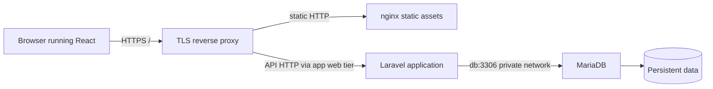

# Laravel React MariaDB Architecture

Trace a request across browser, HTTP API, and database boundaries.

> [!info] Example status
> Written with official references; no Docker commands, installations, workflows, registry changes, or deployments were executed for this vault. Expected results are predictions, not captured test evidence. Version tags are readable learning defaults and can move; use reviewed digests for release inputs.

## Learning objectives

Trace a request across browser, HTTP API, and database boundaries. You will also identify the relevant configuration, recognize failure conditions, and complete a small practice task.

## Questions answered

- How do React, Laravel, and MariaDB communicate in a containerized application?

## Prerequisites

Workflow examples target GitHub Actions on `ubuntu-24.04`; shell commands use Bash unless explicitly executed with `sh`. An internet connection and permission to use the selected practice environment are needed for downloads or remote operations. Windows users should use an appropriately configured WSL2 Ubuntu shell for these Bash examples; they are not PowerShell commands. macOS users need Docker Desktop or another Linux Engine and must adapt Linux-only UID/path behavior.

Earlier lessons: [[02 - Docker Development/04 - Laravel and MariaDB Networking|Laravel and MariaDB Networking]], [[02 - Docker Development/07 - Multi-stage Docker Builds|Multi-stage Docker Builds]].

## Introduction, purpose, and how it works

React code executes in the browser after a server supplies static assets. Laravel receives API requests and enforces validation and authorization. Laravel contacts MariaDB through a private network connection. A browser must never receive database credentials or connect directly to a Compose service hostname. A same-origin reverse proxy can route /api to Laravel while serving frontend assets, reducing cross-origin complexity. Separate origins need deliberate CORS, authentication, and cookie/CSRF configuration.

## Syntax and configuration

| Keyword or syntax | Definition and purpose | When to use it and common mistakes |
| --- | --- | --- |
| `/api` | A conventional HTTP route prefix | Use proxy routing that matches actual backend routes. |
| `DB_HOST=db` | Backend network addressing | Never place it in browser database configuration. |

The practical example below shows these concepts in context; do not run an isolated reference row without its stated prerequisites.

## Practical example

**Execution context:** Local development or reading exercise. The walkthrough identifies filenames and the machine where each operation belongs.

## Step-by-step walkthrough

1. Read the diagram as an architecture review; it does not define a ready-to-run proxy or a PHP-FPM configuration. Use the earlier complete local Laravel stack to explore backend connectivity separately.

2. Identify where each hostname is resolved. db is resolved inside the Compose network; the browser uses public DNS names.

3. List public routes and private ports. Expose only the intended HTTP/TLS entry point, not the database or Docker socket.

4. Define where secrets live, how user identity reaches Laravel, and where authorization is checked. React visibility rules never replace backend access checks.

5. For an existing application, trace one actual request using browser developer tools and backend logs without recording personal data or credentials.

## Expected result

A written request trace identifies the component, protocol, address scope, and authorization responsibility at every hop.

## Practice

Draw a request that should be denied. Success: show Laravel rejecting it even if the browser calls the API directly.

## Common errors and troubleshooting

Browser cannot resolve db: a backend-only name leaked into frontend configuration. Mixed-content failure: HTTPS pages called an HTTP API. CORS error: inspect origin policy and preflight; do not blindly allow every origin with credentials.

## Knowledge check

1. Where does React execute?
2. Who should know database credentials?
3. Who authorizes API access?
4. Can the browser resolve Compose db?
5. What must a PHP-FPM tier receive?

> [!question]- Answers
> 1. In the browser.
> 2. Trusted backend services.
> 3. Laravel/backend policy.
> 4. Normally no.
> 5. FastCGI from a compatible HTTP web tier, not arbitrary HTTP directly.

## Cleanup

No infrastructure is created by the diagram. Remove only temporary diagnostic data produced in your own test environment.

## Related lessons

- [[00 - Learning Roadmap|Full learning checklist]]
- [[GitHub Actions/GitHub Actions Index|GitHub Actions learning path]]
- [[GitHub Actions/GitHub Actions Questions|GitHub Actions questions]]
- [[02 - Docker Development/04 - Laravel and MariaDB Networking|Laravel and MariaDB Networking]]
- [[02 - Docker Development/07 - Multi-stage Docker Builds|Multi-stage Docker Builds]]
- [[06 - Practical Examples/05 - CI CD Pipeline Walkthrough|Next in the roadmap: CI CD Pipeline Walkthrough]]

## Official references

- [Network official documentation](https://docs.docker.com/engine/network/)
- [Laravel official documentation](https://laravel.com/docs/13.x/deployment)
- [Compose official documentation](https://docs.docker.com/reference/compose-file/services/)

---

## 📚 Lesson Navigation

| ⬅️ Previous Lesson | Next Lesson ➡️ |
|:------------------|----------------:|
| [[06 - Practical Examples/03 - GitHub Actions YAML Examples\|GitHub Actions YAML Examples]] | [[06 - Practical Examples/05 - CI CD Pipeline Walkthrough\|CI CD Pipeline Walkthrough]] |

🏠 [[00 - Learning Roadmap|Back to Learning Roadmap]]
