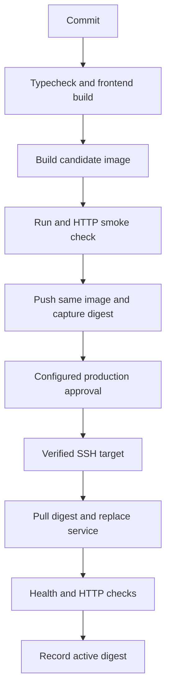

# CI CD Pipeline Walkthrough

Walk through the complete capstone and identify evidence at each boundary.

> [!info] Example status
> Written with official references; no Docker commands, installations, workflows, registry changes, or deployments were executed for this vault. Expected results are predictions, not captured test evidence. Version tags are readable learning defaults and can move; use reviewed digests for release inputs.

## Learning objectives

Walk through the complete capstone and identify evidence at each boundary. You will also identify the relevant configuration, recognize failure conditions, and complete a small practice task.

## Questions answered

- How do I review a release pipeline before trusting it?

## Prerequisites

Workflow examples target GitHub Actions on `ubuntu-24.04`; shell commands use Bash unless explicitly executed with `sh`. An internet connection and permission to use the selected practice environment are needed for downloads or remote operations. Windows users should use an appropriately configured WSL2 Ubuntu shell for these Bash examples; they are not PowerShell commands. macOS users need Docker Desktop or another Linux Engine and must adapt Linux-only UID/path behavior.

Earlier lessons: [[05 - Advanced CI CD/10 - Complete CI CD Pipeline|Complete CI CD Pipeline]].

## Introduction, purpose, and how it works

A trustworthy pipeline has a chain of evidence: source revision, validated dependency graph, tested image, registry digest, approval, deployment identity, and runtime outcome. A successful build without a deployment check leaves a gap. Conversely, a deployment may change the server before failing its smoke check, so a red job does not always mean nothing changed. This lesson reviews the runnable capstone rather than maintaining a second divergent pipeline.

## Syntax and configuration

| Keyword or syntax | Definition and purpose | When to use it and common mistakes |
| --- | --- | --- |
| `Gate` | A check or policy that blocks progression | Use evidence appropriate to the next operation. |
| `Release record` | A durable mapping of source, artifact, target, and outcome | Use it for audit and recovery. |

The practical example below shows these concepts in context; do not run an isolated reference row without its stated prerequisites.

## Practical example

**Execution context:** Local development or reading exercise. The walkthrough identifies filenames and the machine where each operation belongs.

## Step-by-step walkthrough

1. Open Complete CI CD Pipeline and read the full workflow next to this diagram. Use the stated prerequisites; do not trigger it against an unknown server.

2. At each transition, identify the output and its consumer. Build produces a local image, push produces a registry relationship/digest, the job output carries that reference, and the server receives it through SSH.

3. Check failures before push, between push and deploy, and after server replacement. Write down which artifacts and runtime changes remain at each failure point.

4. Review credentials separately: read source, write packages in the build job, SSH in the protected deploy job, and read packages on the server.

5. If later testing on disposable resources, compare source SHA, workflow run, package digest, server image, and HTTP result. A job name or printed success message is not evidence of actual deployment.

## Expected result

A review record explains what each gate proves and which failures require rollback or cleanup.

## Practice

Choose a failing server health check scenario. Success: explain why the image can be published and the server changed even though the workflow is red.

## Common errors and troubleshooting

“Green but wrong release”: verify the tested artifact equals the deployed digest. “Red means untouched”: inspect the last successful remote command. Missing artifact provenance: record exact source and build references.

## Knowledge check

1. What links source to build?
2. What crosses to deployment?
3. Can a failed job have changed the server?
4. Does a package upload imply deployment?
5. Where is runnable configuration?

> [!question]- Answers
> 1. The workflow commit and recorded image metadata.
> 2. A digest reference.
> 3. Yes.
> 4. No.
> 5. The linked Complete CI CD Pipeline lesson.

## Cleanup

This review creates no resources. If running the capstone later, use its runner cleanup and separately manage persistent packages and server releases.

## Related lessons

- [[00 - Learning Roadmap|Full learning checklist]]
- [[GitHub Actions/GitHub Actions Index|GitHub Actions learning path]]
- [[GitHub Actions/GitHub Actions Questions|GitHub Actions questions]]
- [[05 - Advanced CI CD/10 - Complete CI CD Pipeline|Complete CI CD Pipeline]]
- [[06 - Practical Examples/06 - Common Errors and Solutions|Next in the roadmap: Common Errors and Solutions]]

## Official references

- [Ci official documentation](https://docs.docker.com/build/ci/github-actions/)
- [Publish official documentation](https://docs.github.com/en/actions/tutorials/publish-packages/publish-docker-images)
- [Env official documentation](https://docs.github.com/en/actions/how-tos/deploy/configure-and-manage-deployments/manage-environments)

---

## 📚 Lesson Navigation

| ⬅️ Previous Lesson | Next Lesson ➡️ |
|:------------------|----------------:|
| [[06 - Practical Examples/04 - Laravel React MariaDB Architecture\|Laravel React MariaDB Architecture]] | [[06 - Practical Examples/06 - Common Errors and Solutions\|Common Errors and Solutions]] |

🏠 [[00 - Learning Roadmap|Back to Learning Roadmap]]
