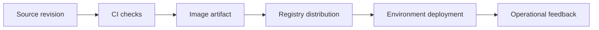

# DevOps Glossary

Translate operational vocabulary into concrete actions and responsibilities.

> [!info] Example status
> Written with official references; no Docker commands, installations, workflows, registry changes, or deployments were executed for this vault. Expected results are predictions, not captured test evidence. Version tags are readable learning defaults and can move; use reviewed digests for release inputs.

## Learning objectives

Translate operational vocabulary into concrete actions and responsibilities. You will also identify the relevant configuration, recognize failure conditions, and complete a small practice task.

## Questions answered

- What do the common Docker and CI/CD terms mean?

## Prerequisites

Workflow examples target GitHub Actions on `ubuntu-24.04`; shell commands use Bash unless explicitly executed with `sh`. An internet connection and permission to use the selected practice environment are needed for downloads or remote operations. Windows users should use an appropriately configured WSL2 Ubuntu shell for these Bash examples; they are not PowerShell commands. macOS users need Docker Desktop or another Linux Engine and must adapt Linux-only UID/path behavior.

Earlier lessons: [[01 - Docker Fundamentals/01 - Introduction to Docker|Introduction to Docker]], [[03 - GitHub Actions Fundamentals/01 - Introduction to CI CD|Introduction to CI CD]].

## Introduction, purpose, and how it works

DevOps joins software delivery and operation through shared ownership, automation, feedback, and recovery practices. Tools support that work but do not replace it. The same word can have several meanings: an image tag differs from a Git tag, a Docker network differs from public DNS, and a successful build differs from a successful release. Use the glossary to resolve terminology before copying configuration.

## Syntax and configuration

| Keyword or syntax | Definition and purpose | When to use it and common mistakes |
| --- | --- | --- |
| `Image` | A filesystem template and startup metadata | Use to distribute a runtime consistently. |
| `Container` | An instance with process and writable state | Use to execute an image. |
| `Registry` | An artifact distribution service | Use to publish and retrieve images. |
| `Artifact` | A produced output retained or distributed | Use for immutable release candidates. |
| `Cache` | Replaceable performance data | Use to speed work, never as the sole release record. |
| `CI` | Automated checks on integrated changes | Use for rapid feedback. |
| `Continuous delivery` | Keep validated changes ready to release | Use with an explicit deployment decision. |
| `Continuous deployment` | Automatically release accepted changes | Use only with sufficient gates and recovery. |
| `OIDC` | Federated identity using signed tokens | Use provider-supported short-lived credentials with restrictive trust claims, not as an automatic replacement for every registry token. |
| `Provenance` | Evidence describing an artifact’s origin and build | Use with verification policy; a label alone is not proof. |
| `Rollback` | Restore compatible earlier application code | Use with a reviewed data/schema strategy. |
| `Restore` | Recover persisted data from a backup | Use a tested procedure and known recovery objectives. |

The practical example below shows these concepts in context; do not run an isolated reference row without its stated prerequisites.

## Practical example

**Execution context:** Local development or reading exercise. The walkthrough identifies filenames and the machine where each operation belongs.

## Step-by-step walkthrough

1. Read the terms below, then open the linked lesson for any term you cannot explain with a concrete example.

2. Trace one frontend release: source enters CI, the image becomes an artifact, the registry stores it, and deployment selects its digest.

3. Separate identity from policy: a credential authenticates, permissions authorize, and an approval controls when a protected action may proceed.

4. Explain recovery separately from deployment: rollback changes compatible code, restore reconstructs persisted data, and monitoring detects whether the user-facing service works.

## Expected result

You can explain the release path and identify the right detailed lesson without relying on plugin features.

## Practice

Describe the complete capstone in five sentences using artifact, digest, runner, environment, and rollback correctly. Success: each term maps to an observable component or action.

## Common errors and troubleshooting

Calling a container an image hides mutable runtime state. Calling a volume a backup hides shared failure risk. Calling continuous delivery automatic deployment hides the human decision boundary.

## Knowledge check

1. What is an artifact?
2. What is a runner?
3. What is a digest?
4. What is restore?
5. What is least privilege?

> [!question]- Answers
> 1. A produced distributable output such as an image.
> 2. A job execution machine or process.
> 3. A content-addressed artifact identity.
> 4. Reconstruction of persisted data from backup.
> 5. Only the access needed for a task.

## Cleanup

This is a reading exercise; no resources or files outside documentation are needed.

## Related lessons

- [[00 - Learning Roadmap|Full learning checklist]]
- [[Docker/Docker Index|Docker learning path]]
- [[Docker/Docker Questions|Docker questions]]
- [[GitHub Actions/GitHub Actions Index|GitHub Actions learning path]]
- [[GitHub Actions/GitHub Actions Questions|GitHub Actions questions]]
- [[01 - Docker Fundamentals/01 - Introduction to Docker|Introduction to Docker]]
- [[03 - GitHub Actions Fundamentals/01 - Introduction to CI CD|Introduction to CI CD]]

## Official references

- [Docker official documentation](https://docs.docker.com/get-started/)
- [Ci official documentation](https://docs.docker.com/build/ci/github-actions/)
- [Registry official documentation](https://docs.github.com/en/packages/working-with-a-github-packages-registry/working-with-the-container-registry)

---

## 📚 Lesson Navigation

| ⬅️ Previous Lesson | Next Lesson ➡️ |
|:------------------|----------------:|
| [[07 - References/04 - GitHub Actions YAML Reference\|GitHub Actions YAML Reference]] | [[08 - Dockerfile and Compose Mastery/00 - Mastery Roadmap\|Mastery Roadmap]] |

🏠 [[00 - Learning Roadmap|Back to Learning Roadmap]]
