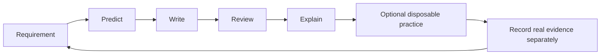

# Mastery Roadmap

Follow a focused path from empty configuration files to an independently reviewed stack.

> [!info] Documentation-only module
> Official references were checked on 2026-10-21. No Docker command, installation, application build, workflow, or deployment was executed. Expected outputs are illustrative. Complete runnable examples and intentionally incorrect fragments are labeled separately.

## Learning objectives

Follow a focused path from empty configuration files to an independently reviewed stack.

## Questions answered

- How should I study Dockerfile and Compose mastery?

## Prerequisites and execution context

Examples use Ubuntu Linux and Bash with Docker Engine, BuildKit, and the Compose v2 plugin (docker compose). No installation is performed by these notes. Use WSL2 Ubuntu for Bash on Windows; these are not PowerShell commands. Docker Desktop users on macOS must account for Linux VM paths, permissions, and architecture. Readable image tags here are not immutable release pins; review supported versions and use recorded digests for release reproducibility.

Unless identified as a reference fragment, illustrated files belong in a new disposable lab directory when you choose to practice. This vault stores those files only as Markdown examples. Existing-application exercises name their additional prerequisites explicitly.

## Explanation

This module deepens the existing vault rather than replacing its introductory notes. Work in order through recipe syntax and lifecycle, context and cache, then YAML and runtime models, and finally integration, security, exercises and review. The references are detailed lookup notes; revisit them while writing rather than trying to memorize every flag.

The capstone uses existing application prerequisites and local development assumptions. Completing the reading is different from executing a lab. Checkboxes record study progress; record any future command results with actual tool versions and environment separately.

## Syntax reference

Thirty lessons plus this roadmap. Dockerfile examples are image recipes; compose.yml examples use the current Compose Specification without a legacy version field. Shell examples target Ubuntu Bash unless an explicit sh script is shown.

## Code examples

**Learning cycle:**

**Incorrect learning shortcut:** a pasted file that cannot be explained line by line does not satisfy mastery.

## Line-by-line walkthrough

1. Read the introductory image/container and Compose notes if terminology is unfamiliar.

2. Study lessons 1–10 to understand what creates an image and what waits until startup.

3. Study lessons 11–21 to understand resolved runtime configuration and its types/defaults.

4. Build a mental model with lessons 22–27 before attempting the exercise set.

5. Attempt all 15 exercises before opening solutions, then take the final assessment.

6. Use the subject question list to return to the exact concept that caused a wrong prediction.

## DO ✅ / DON'T ❌

- **DO ✅** Predict behavior before reading answers, because error correction improves the model you actually use.
- **DO ✅** Keep configuration reasoning and execution evidence separate, because documentation review is not a passed lab.

- **DON'T ❌** Skip data-lifetime and secret sections just because examples are local, because these mistakes are expensive to carry into real systems.
- **DON'T ❌** Install or deploy merely to read the module; all content is usable as ordinary Markdown.

## Expected result

You distinguish build inputs, image metadata, runtime configuration, networking, durable data and secret delivery. This is an expected result, not an execution claim.

## Common errors and troubleshooting

If the full stack feels confusing, return to the small report example and trace one lifecycle at a time. If navigation looks ambiguous, use the full vault-relative links below rather than similar names in older sections.

## Practice exercise

**Problem and objective:** Complete the study checklist and explain one setting from each lifecycle without looking it up.

**Success condition:** You distinguish build inputs, image metadata, runtime configuration, networking, durable data and secret delivery.

**Hint:** Use the comparison tables and two reference notes as lookup aids.

## Knowledge check

1. Do checkboxes prove commands passed?
2. Where are recipe instructions explained in detail?
3. Where are Compose property types/defaults documented?
4. How many worked exercises are provided?
5. Is the capstone automatically production-ready?

> [!question]- Answers
> 1. No.
> 2. Lesson 2.
> 3. Lesson 12.
> 4. Fifteen in lesson 28.
> 5. No.

## Dockerfile construction

- [ ] [[08 - Dockerfile and Compose Mastery/01 - Dockerfile Syntax Fundamentals|Dockerfile Syntax Fundamentals]]
- [ ] [[08 - Dockerfile and Compose Mastery/02 - Dockerfile Instructions Reference|Dockerfile Instructions Reference]]
- [ ] [[08 - Dockerfile and Compose Mastery/03 - FROM RUN CMD and ENTRYPOINT|FROM RUN CMD and ENTRYPOINT]]
- [ ] [[08 - Dockerfile and Compose Mastery/04 - COPY ADD WORKDIR and USER|COPY ADD WORKDIR and USER]]
- [ ] [[08 - Dockerfile and Compose Mastery/05 - ARG ENV EXPOSE and VOLUME|ARG ENV EXPOSE and VOLUME]]
- [ ] [[08 - Dockerfile and Compose Mastery/06 - Build Context and Dockerignore|Build Context and Dockerignore]]
- [ ] [[08 - Dockerfile and Compose Mastery/07 - Docker Layer Caching|Docker Layer Caching]]
- [ ] [[08 - Dockerfile and Compose Mastery/08 - Multi-stage Builds|Multi-stage Builds]]
- [ ] [[08 - Dockerfile and Compose Mastery/09 - Dockerfile Best Practices|Dockerfile Best Practices]]
- [ ] [[08 - Dockerfile and Compose Mastery/10 - Dockerfile Anti-patterns|Dockerfile Anti-patterns]]

## Compose construction

- [ ] [[08 - Dockerfile and Compose Mastery/11 - Compose YAML Syntax Fundamentals|Compose YAML Syntax Fundamentals]]
- [ ] [[08 - Dockerfile and Compose Mastery/12 - Compose Services and Images|Compose Services and Images]]
- [ ] [[08 - Dockerfile and Compose Mastery/13 - Compose Build and Dockerfile Integration|Compose Build and Dockerfile Integration]]
- [ ] [[08 - Dockerfile and Compose Mastery/14 - Compose Ports and Networks|Compose Ports and Networks]]
- [ ] [[08 - Dockerfile and Compose Mastery/15 - Compose Volumes and Bind Mounts|Compose Volumes and Bind Mounts]]
- [ ] [[08 - Dockerfile and Compose Mastery/16 - Compose Environment Variables|Compose Environment Variables]]
- [ ] [[08 - Dockerfile and Compose Mastery/17 - Compose Depends On and Healthchecks|Compose Depends On and Healthchecks]]
- [ ] [[08 - Dockerfile and Compose Mastery/18 - Compose Commands and Entrypoints|Compose Commands and Entrypoints]]
- [ ] [[08 - Dockerfile and Compose Mastery/19 - Compose Profiles and Overrides|Compose Profiles and Overrides]]
- [ ] [[08 - Dockerfile and Compose Mastery/20 - Compose Best Practices|Compose Best Practices]]
- [ ] [[08 - Dockerfile and Compose Mastery/21 - Compose Anti-patterns|Compose Anti-patterns]]

## Integration and independent practice

- [ ] [[08 - Dockerfile and Compose Mastery/22 - Dockerfile vs Compose|Dockerfile vs Compose]]
- [ ] [[08 - Dockerfile and Compose Mastery/23 - Dockerfile and Compose Together|Dockerfile and Compose Together]]
- [ ] [[08 - Dockerfile and Compose Mastery/24 - Laravel React MariaDB Example|Laravel React MariaDB Example]]
- [ ] [[08 - Dockerfile and Compose Mastery/25 - Development vs Production|Development vs Production]]
- [ ] [[08 - Dockerfile and Compose Mastery/26 - Debugging Docker Configurations|Debugging Docker Configurations]]
- [ ] [[08 - Dockerfile and Compose Mastery/27 - Security and Secrets|Security and Secrets]]
- [ ] [[08 - Dockerfile and Compose Mastery/28 - Practice Exercises|Practice Exercises]]
- [ ] [[08 - Dockerfile and Compose Mastery/29 - Common Errors and Solutions|Common Errors and Solutions]]
- [ ] [[08 - Dockerfile and Compose Mastery/30 - Final Assessment|Final Assessment]]

## Cleanup

Reading and editing the Markdown examples creates no Docker resources. If you later run a lab, remove only its named containers/images or its explicitly selected Compose project. docker compose down removes project containers and networks while preserving named volumes; adding --volumes destroys project volume data and belongs only in a confirmed disposable lab. Preserve needed diagnostics before removal.

## Related lessons

- [[08 - Dockerfile and Compose Mastery/00 - Mastery Roadmap|Mastery Roadmap]]
- [[Docker/Docker Index|Docker learning path]]
- [[Docker/Docker Questions|Docker learner questions]]
- [[08 - Dockerfile and Compose Mastery/01 - Dockerfile Syntax Fundamentals|Dockerfile Syntax Fundamentals]]

## Official references

- [File documentation](https://docs.docker.com/reference/dockerfile/)
- [Compose documentation](https://docs.docker.com/reference/compose-file/)
- [Best documentation](https://docs.docker.com/build/building/best-practices/)
- [Overview documentation](https://docs.docker.com/compose/)

---

## 📚 Lesson Navigation

| ⬅️ Previous Lesson | Next Lesson ➡️ |
|:------------------|----------------:|
| [[07 - References/05 - DevOps Glossary\|DevOps Glossary]] | [[08 - Dockerfile and Compose Mastery/01 - Dockerfile Syntax Fundamentals\|Dockerfile Syntax Fundamentals]] |

🏠 [[00 - Learning Roadmap|Back to Learning Roadmap]]
