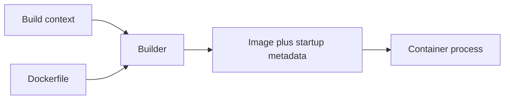

# Dockerfile Syntax Fundamentals

Write a complete Dockerfile and distinguish parsing, build execution, and container startup.

> [!info] Documentation-only module
> Official references were checked on 2026-10-21. No Docker command, installation, application build, workflow, or deployment was executed. Expected outputs are illustrative. Complete runnable examples and intentionally incorrect fragments are labeled separately.

## Learning objectives

Write a complete Dockerfile and distinguish parsing, build execution, and container startup.

## Questions answered

- How do I write a Dockerfile from an empty file?

## Prerequisites and execution context

Examples use Ubuntu Linux and Bash with Docker Engine, BuildKit, and the Compose v2 plugin (docker compose). No installation is performed by these notes. Use WSL2 Ubuntu for Bash on Windows; these are not PowerShell commands. Docker Desktop users on macOS must account for Linux VM paths, permissions, and architecture. Readable image tags here are not immutable release pins; review supported versions and use recorded digests for release reproducibility.

Unless identified as a reference fragment, illustrated files belong in a new disposable lab directory when you choose to practice. This vault stores those files only as Markdown examples. Existing-application exercises name their additional prerequisites explicitly.

## Explanation

A Dockerfile is a recipe read by an image builder. Its instructions select a parent filesystem, change files, and save runtime metadata. The container process starts later, when an image is run. Instruction names are conventionally uppercase. Arguments have their own case and quoting rules. A whole-line # comment is Dockerfile commentary; an inline # in a shell command is interpreted by that shell instead.

A parser directive belongs before ordinary content. The syntax directive chooses the Dockerfile frontend, which determines supported build features. A continuation backslash must end its line: trailing characters or whitespace can break the instruction. Exec form is JSON, not a Bash array; it needs double quotes and has no automatic shell expansion.

## Syntax reference

General grammar: INSTRUCTION arguments. RUN, CMD, and ENTRYPOINT support shell and exec forms. Linux shell form normally uses /bin/sh -c. The stable docker/dockerfile:1 frontend follows updates; exact frontend pinning is a separate reproducibility decision.

## Code examples

**Complete Dockerfile; no companion source files:**
```dockerfile
# syntax=docker/dockerfile:1
FROM alpine:3.22
WORKDIR /lesson
RUN printf "hello from a build\n" > message.txt
CMD ["cat", "/lesson/message.txt"]
```

**Optional local commands from its directory:**
```bash
docker build -t mastery-hello .
docker run --rm mastery-hello
```

**Incorrect JSON fragment:**
```dockerfile
CMD ['cat', '/lesson/message.txt']
```

Single quotes are not JSON string delimiters. Use the complete exec form above.

## Line-by-line walkthrough

1. The first line selects the frontend rather than running a shell command.

2. FROM starts a stage and supplies Alpine executables.

3. WORKDIR creates/selects /lesson.

4. RUN starts a temporary build shell and stores a file in the image filesystem.

5. CMD records default startup argv; it does not read the file during build.

6. The dot supplies build context. The later run starts cat and removes its exited container.

## DO ✅ / DON'T ❌

- **DO ✅** Use one small complete recipe first, because it isolates syntax errors from application errors.
- **DO ✅** Write direct exec arrays with double quotes, because JSON and shell quoting differ.

- **DON'T ❌** Run a continuous server with RUN, because it blocks or ends during construction rather than defining startup.
- **DON'T ❌** Place whitespace after a continuation backslash, because the next line can become a separate instruction.

## Expected result

Your annotation distinguishes build execution from saved startup metadata; a future run would print hello from a build. This is an expected result, not an execution claim.

## Common errors and troubleshooting

Unknown instruction can mean a spelling error or broken continuation. A JSON error often means single quotes or trailing commas. A successful build does not prove CMD names an installed executable.

## Practice exercise

**Problem and objective:** Write the greeting image from memory and mark the phase of every line.

**Success condition:** Your annotation distinguishes build execution from saved startup metadata; a future run would print hello from a build.

**Hint:** Only RUN executes the file-writing command during construction.

## Knowledge check

1. Who reads the recipe?
2. Does CMD execute at build time?
3. Are single quotes valid JSON delimiters?
4. Where do parser directives belong?
5. Does build success prove startup?

> [!question]- Answers
> 1. The builder frontend.
> 2. No.
> 3. No.
> 4. Before ordinary content.
> 5. No.

## Build and startup diagram




## Cleanup

Reading and editing the Markdown examples creates no Docker resources. If you later run a lab, remove only its named containers/images or its explicitly selected Compose project. docker compose down removes project containers and networks while preserving named volumes; adding --volumes destroys project volume data and belongs only in a confirmed disposable lab. Preserve needed diagnostics before removal.

## Parser directive details


| Directive | Meaning and limitation |
| --- | --- |
| # syntax=docker/dockerfile:1 | Selects the frontend; the stable tag follows updates. Choose a reviewed frontend digest when freezing parser behavior is a requirement. |
| # escape=BACKSLASH_OR_BACKTICK | Changes Dockerfile escape/continuation character, often useful for Windows recipes. It does not change shell quoting or make Linux paths Windows paths. |
| # check=skip=JSONArgsRecommended | Controls compatible frontend build checks. Rule names are case-sensitive; skipping a warning is not a correctness fix. error=true can make check findings fail the build where supported. |

Use directives once at the top before ordinary comments, blank content or instructions can terminate directive recognition. The directive keys should use documented spelling. The escape directive value is a single supported escape character, not the literal explanatory name in this table. This module uses default backslash continuation and Linux shells.

A shell && chain runs a following command only after success; ; runs the next command regardless. A pipe connects stdout to another command and can mask earlier failure depending on shell options. Exec JSON arrays do not interpret any of those operators.

## Related lessons

- [[08 - Dockerfile and Compose Mastery/00 - Mastery Roadmap|Mastery Roadmap]]
- [[Docker/Docker Index|Docker learning path]]
- [[Docker/Docker Questions|Docker learner questions]]
- [[08 - Dockerfile and Compose Mastery/02 - Dockerfile Instructions Reference|Dockerfile Instructions Reference]]

## Official references

- [File documentation](https://docs.docker.com/reference/dockerfile/)

---

## 📚 Lesson Navigation

| ⬅️ Previous Lesson | Next Lesson ➡️ |
|:------------------|----------------:|
| [[08 - Dockerfile and Compose Mastery/00 - Mastery Roadmap\|Mastery Roadmap]] | [[08 - Dockerfile and Compose Mastery/02 - Dockerfile Instructions Reference\|Dockerfile Instructions Reference]] |

🏠 [[00 - Learning Roadmap|Back to Learning Roadmap]]
