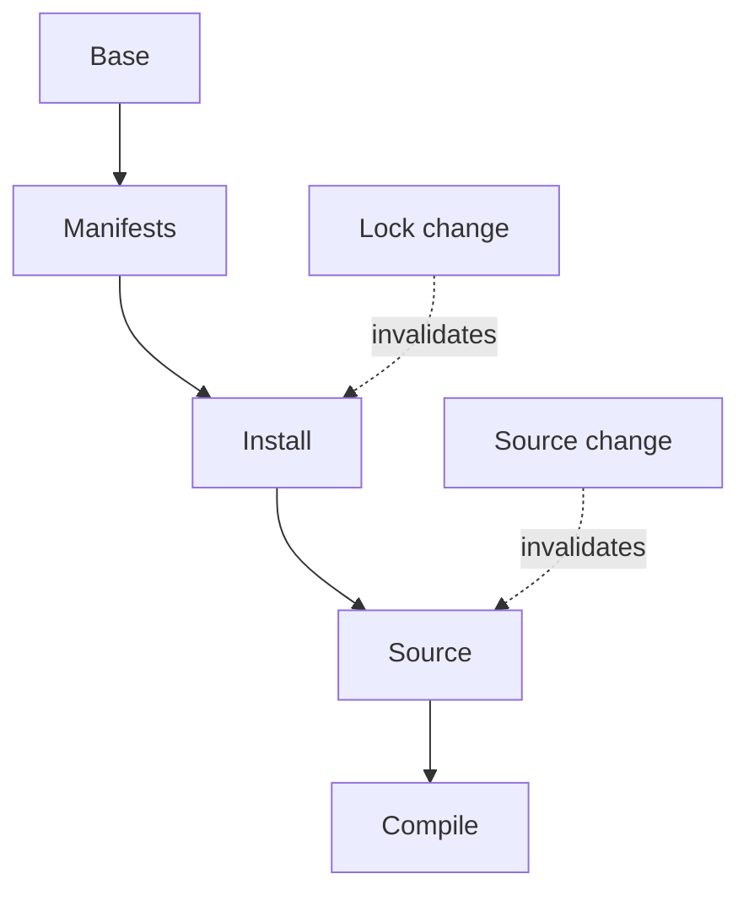

# Docker Layer Caching

Design dependency boundaries that make rebuilds both fast and correct.

> [!info] Documentation-only module
> Official references were checked on 2026-10-21. No Docker command, installation, application build, workflow, or deployment was executed. Expected outputs are illustrative. Complete runnable examples and intentionally incorrect fragments are labeled separately.

## Learning objectives

Design dependency boundaries that make rebuilds both fast and correct.

## Questions answered

- How do build layers and cache mounts affect my recipe?

## Prerequisites and execution context

Examples use Ubuntu Linux and Bash with Docker Engine, BuildKit, and the Compose v2 plugin (docker compose). No installation is performed by these notes. Use WSL2 Ubuntu for Bash on Windows; these are not PowerShell commands. Docker Desktop users on macOS must account for Linux VM paths, permissions, and architecture. Readable image tags here are not immutable release pins; review supported versions and use recorded digests for release reproducibility.

Read first: [[08 - Dockerfile and Compose Mastery/06 - Build Context and Dockerignore|Build Context and Dockerignore]].

Unless identified as a reference fragment, illustrated files belong in a new disposable lab directory when you choose to practice. This vault stores those files only as Markdown examples. Existing-application exercises name their additional prerequisites explicitly.

## Explanation

A build result is reusable when its instruction and relevant inputs match. Changes propagate through dependent steps. A cached RUN does not automatically re-query remote repositories for newer packages; freshness needs an update policy. A cache mount is temporary build storage such as downloaded npm packages, not the final installed application content. Correct builds must work with empty caches.

BuildKit also supports temporary bind, tmpfs, secret, and SSH mounts. Bind mounts can expose build inputs without persisting copied source in that step; tmpfs is ephemeral memory-backed scratch. SSH mounts forward an agent/socket rather than copying keys, but the command receiving access must still be trusted. RUN --network=none restricts a step; privileged entitlements and special device/security features are advanced, backend-specific choices, not safe defaults.

## Syntax reference

RUN --mount=type=cache,target=/path reuses downloads where supported. --no-cache affects instruction-result reuse; --pull refreshes base resolution. Neither substitutes for locked dependencies or reviewed patching.

## Code examples

**Existing Node-project Dockerfile; requires lock file and build script:**
```dockerfile
# syntax=docker/dockerfile:1
FROM node:22-bookworm-slim
WORKDIR /app
COPY package.json package-lock.json ./
RUN --mount=type=cache,target=/root/.npm npm ci
COPY . .
RUN npm run build
```

**Inferior dependency ordering fragment:**
```dockerfile
COPY . .
RUN npm ci
```

A source-only edit invalidates installation unnecessarily; copy manifests first instead.

## Line-by-line walkthrough

1. The frontend enables supported mount features.

2. Manifest COPY isolates dependency inputs.

3. npm ci enforces the lock while the mount reuses download cache, not authoritative node_modules.

4. COPY source comes after installation; compilation still reruns when code changes.

5. A lock change should invalidate installation. Platform, base, arguments and instruction changes can also change reuse.

## DO ✅ / DON'T ❌

- **DO ✅** Make cache optional for correctness, because a new builder may have none.
- **DO ✅** Combine related package-index update/install/cleanup, because stale cached indexes cause failures.

- **DON'T ❌** Optimize only instruction count, because unreadable chains can obscure failures and destroy useful cache boundaries.
- **DON'T ❌** Export caches publicly without reviewing their contents, because intermediate data can be sensitive.

## Expected result

Your prediction preserves install reuse for source-only changes and invalidates it for dependency changes. This is an expected result, not an execution claim.

## Common errors and troubleshooting

Unexpected misses: inspect changed inputs and platform. Unexpected staleness: distinguish cached results from fresh network resolution. Cache mount contents may survive --no-cache; choose invalidation deliberately.

## Practice exercise

**Problem and objective:** Predict rebuild steps after a source edit and after a lock-file edit.

**Success condition:** Your prediction preserves install reuse for source-only changes and invalidates it for dependency changes.

**Hint:** Draw input dependency arrows.

## Knowledge check

1. Does cached RUN fetch newer packages automatically?
2. Is cache a release artifact?
3. What changes install inputs?
4. Does --pull mean all steps rerun?
5. Should cold cache break correctness?

> [!question]- Answers
> 1. No.
> 2. No.
> 3. Manifests, locks, base, relevant arguments and instruction content.
> 4. No.
> 5. No.

## Cache dependency diagram




## Cleanup

Reading and editing the Markdown examples creates no Docker resources. If you later run a lab, remove only its named containers/images or its explicitly selected Compose project. docker compose down removes project containers and networks while preserving named volumes; adding --volumes destroys project volume data and belongs only in a confirmed disposable lab. Preserve needed diagnostics before removal.

## Related lessons

- [[08 - Dockerfile and Compose Mastery/00 - Mastery Roadmap|Mastery Roadmap]]
- [[Docker/Docker Index|Docker learning path]]
- [[Docker/Docker Questions|Docker learner questions]]
- [[08 - Dockerfile and Compose Mastery/06 - Build Context and Dockerignore|Build Context and Dockerignore]]
- [[08 - Dockerfile and Compose Mastery/08 - Multi-stage Builds|Multi-stage Builds]]

## Official references

- [Cache documentation](https://docs.docker.com/build/cache/optimize/)
- [Secret documentation](https://docs.docker.com/build/building/secrets/)
- [Context documentation](https://docs.docker.com/build/concepts/context/)

---

## 📚 Lesson Navigation

| ⬅️ Previous Lesson | Next Lesson ➡️ |
|:------------------|----------------:|
| [[08 - Dockerfile and Compose Mastery/06 - Build Context and Dockerignore\|Build Context and Dockerignore]] | [[08 - Dockerfile and Compose Mastery/08 - Multi-stage Builds\|Multi-stage Builds]] |

🏠 [[00 - Learning Roadmap|Back to Learning Roadmap]]
