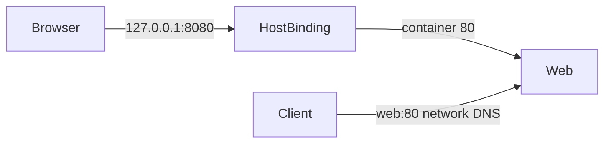

# Compose Ports and Networks

Distinguish host publication, peer addressing, and external DNS.

> [!info] Documentation-only module
> Official references were checked on 2026-10-21. No Docker command, installation, application build, workflow, or deployment was executed. Expected outputs are illustrative. Complete runnable examples and intentionally incorrect fragments are labeled separately.

## Learning objectives

Distinguish host publication, peer addressing, and external DNS.

## Questions answered

- How should I connect services without exposing every port?

## Prerequisites and execution context

Examples use Ubuntu Linux and Bash with Docker Engine, BuildKit, and the Compose v2 plugin (docker compose). No installation is performed by these notes. Use WSL2 Ubuntu for Bash on Windows; these are not PowerShell commands. Docker Desktop users on macOS must account for Linux VM paths, permissions, and architecture. Readable image tags here are not immutable release pins; review supported versions and use recorded digests for release reproducibility.

Read first: [[08 - Dockerfile and Compose Mastery/13 - Compose Build and Dockerfile Integration|Compose Build and Dockerfile Integration]].

Unless identified as a reference fragment, illustrated files belong in a new disposable lab directory when you choose to practice. This vault stores those files only as Markdown examples. Existing-application exercises name their additional prerequisites explicitly.

## Explanation

Services sharing a Compose network normally resolve each other by service key. Internal calls use service name and container port. Published ports allow access through the host and can expose a service beyond the intended audience if a host IP is omitted. expose documents internal ports but is not a firewall; peers can reach listening ports allowed by network connectivity regardless of that metadata.

extra_hosts adds fixed host mappings, while dns selects resolver servers. Neither is a routine fix for an incorrect service name. Network segmentation should follow required connections. internal: true restricts external network access for that network; merely naming a network internal does not.

## Syntax reference


| Setting | Purpose | Scenario |
| --- | --- | --- |
| ports | Publish a host binding | Local browser accesses nginx at 127.0.0.1:8080. |
| expose | Describe container listeners | Document FastCGI 9000 without publishing it. |
| networks | Attach peers | Allow backend to reach db:3306 privately. |


## Code examples

**Complete peer connectivity lab:**
```yaml
services:
  web:
    image: nginx:stable-alpine
    ports: ["127.0.0.1:8080:80"]
    networks: [lab]
  client:
    image: alpine:3.22
    command: ["wget", "-qO-", "http://web:80/"]
    networks: [lab]
    profiles: [tools]
networks:
  lab: {}
```

Optional local sequence: start web, then run the one-off client. The name web resolves inside the network, not in the host browser.

**Incorrect peer command fragment:**
```yaml
command: ["wget", "-qO-", "http://localhost:8080/"]
```

Inside client, localhost means client itself, and 8080 is the host-side mapping. Use web:80.

## Line-by-line walkthrough

1. The host binding limits browser exposure to local loopback.

2. Both services join lab, enabling network DNS.

3. The client requests web port 80 directly, not its host port.

4. The tools profile keeps the client optional for ordinary startup.

5. A future local sequence is docker compose up -d web followed by docker compose run --rm client. A simple nginx server may need brief startup time before the request; add readiness if automating.

## DO ✅ / DON'T ❌

- **DO ✅** Use service DNS names, because recreated containers can have new IP addresses.
- **DO ✅** Publish only needed entry points, because a database host port is often unnecessary.

- **DON'T ❌** Use localhost to reach another container, because each container has its own loopback.
- **DON'T ❌** Treat expose as authorization, because network reachability is a separate concern.

## Expected result

Only the intended HTTP entry point is host-published; backend database calls use db:3306. This is an expected result, not an execution claim.

## Common errors and troubleshooting

Bad address suggests DNS/network membership. Connection refused suggests listener/readiness/port. Browser inability to resolve web is expected outside the Compose network. Investigate each boundary separately.

## Practice exercise

**Problem and objective:** Draw a frontend/backend/database network and mark which port reaches the host.

**Success condition:** Only the intended HTTP entry point is host-published; backend database calls use db:3306.

**Hint:** The browser never connects to MariaDB directly.

## Knowledge check

1. What does localhost mean in client?
2. Which port do peers use?
3. Does expose isolate peers?
4. Does a fixed container IP survive recreation reliably?
5. Why bind loopback?

> [!question]- Answers
> 1. The client container.
> 2. The container listener port.
> 3. No.
> 4. Do not depend on it.
> 5. Restrict host publication to local access.

## Network trace




## Cleanup

Reading and editing the Markdown examples creates no Docker resources. If you later run a lab, remove only its named containers/images or its explicitly selected Compose project. docker compose down removes project containers and networks while preserving named volumes; adding --volumes destroys project volume data and belongs only in a confirmed disposable lab. Preserve needed diagnostics before removal.

## Related lessons

- [[08 - Dockerfile and Compose Mastery/00 - Mastery Roadmap|Mastery Roadmap]]
- [[Docker/Docker Index|Docker learning path]]
- [[Docker/Docker Questions|Docker learner questions]]
- [[08 - Dockerfile and Compose Mastery/13 - Compose Build and Dockerfile Integration|Compose Build and Dockerfile Integration]]
- [[08 - Dockerfile and Compose Mastery/15 - Compose Volumes and Bind Mounts|Compose Volumes and Bind Mounts]]

## Official references

- [Network documentation](https://docs.docker.com/reference/compose-file/networks/)
- [Services documentation](https://docs.docker.com/reference/compose-file/services/)

---

## 📚 Lesson Navigation

| ⬅️ Previous Lesson | Next Lesson ➡️ |
|:------------------|----------------:|
| [[08 - Dockerfile and Compose Mastery/13 - Compose Build and Dockerfile Integration\|Compose Build and Dockerfile Integration]] | [[08 - Dockerfile and Compose Mastery/15 - Compose Volumes and Bind Mounts\|Compose Volumes and Bind Mounts]] |

🏠 [[00 - Learning Roadmap|Back to Learning Roadmap]]
