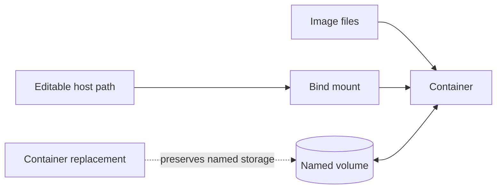

# Compose Volumes and Bind Mounts

Choose persistence and editability deliberately and understand mount masking.

> [!info] Documentation-only module
> Official references were checked on 2026-10-21. No Docker command, installation, application build, workflow, or deployment was executed. Expected outputs are illustrative. Complete runnable examples and intentionally incorrect fragments are labeled separately.

## Learning objectives

Choose persistence and editability deliberately and understand mount masking.

## Questions answered

- When should I use a named volume rather than a bind mount?

## Prerequisites and execution context

Examples use Ubuntu Linux and Bash with Docker Engine, BuildKit, and the Compose v2 plugin (docker compose). No installation is performed by these notes. Use WSL2 Ubuntu for Bash on Windows; these are not PowerShell commands. Docker Desktop users on macOS must account for Linux VM paths, permissions, and architecture. Readable image tags here are not immutable release pins; review supported versions and use recorded digests for release reproducibility.

Read first: [[08 - Dockerfile and Compose Mastery/14 - Compose Ports and Networks|Compose Ports and Networks]].

Unless identified as a reference fragment, illustrated files belong in a new disposable lab directory when you choose to practice. This vault stores those files only as Markdown examples. Existing-application exercises name their additional prerequisites explicitly.

## Explanation

A named volume is Engine-managed storage with its own lifecycle. A bind mount exposes a chosen path on the daemon host. Use named volumes for database data and bind mounts for editable local source or deliberate file configuration. Neither is automatically a backup. A runtime mount hides the underlying image path; it can conceal vendor or node_modules built into /app.

Short syntax is concise but a path typo can produce surprising host directories. Long bind syntax with create_host_path: false can reject missing sources. Relative host paths are for local deployment contexts and should be resolved deliberately. Mount read_only differs from a read-only container root filesystem.

## Syntax reference


| Storage | Choice and reason | Limit |
| --- | --- | --- |
| Named volume | MariaDB data persists across container replacement | Still needs backup and restore testing. |
| Bind mount | Edit host source in a development container | Host permissions/platform paths matter. |
| tmpfs | Ephemeral runtime cache | Data disappears and must not hold durable database state. |


## Code examples

**Complete volume read/write lab:**
```yaml
services:
  writer:
    image: alpine:3.22
    volumes: ["lesson-data:/data"]
    command: ["sh", "-c", "printf persistent > /data/message.txt"]
  reader:
    image: alpine:3.22
    volumes: ["lesson-data:/data:ro"]
    command: ["cat", "/data/message.txt"]
volumes:
  lesson-data: {}
```

Run writer as a one-off before reader if practicing. The two definitions do not automatically order themselves.

**Incorrect assumption fragment:**
```yaml
volumes: ["./source:/app"]
```

This is valid for source editing but can hide /app/vendor installed in an image. Install dependencies into the mounted workspace or redesign the mount boundary.

## Line-by-line walkthrough

1. The top-level volume declares a managed resource.

2. writer attaches it read/write and writes one file.

3. reader attaches the same volume read-only and reads that file.

4. The contents survive one-off container removal.

5. For MariaDB mount its named volume at /var/lib/mysql; mounting somewhere else does not preserve the actual database directory.

## DO ✅ / DON'T ❌

- **DO ✅** Use explicit volume identity for important data, because anonymous volumes are harder to manage.
- **DO ✅** Read cleanup flags before running them, because down --volumes destroys data.

- **DON'T ❌** Copy a running database directory as if it were a guaranteed consistent backup, because live writes can invalidate the snapshot.
- **DON'T ❌** Assume image ownership fixes host permissions, because bind mounts expose host metadata.

## Expected result

You distinguish host configuration input from Engine-managed durable data. This is an expected result, not an execution claim.

## Common errors and troubleshooting

Missing dependencies can be mount masking, not a failed COPY. Read-only errors need a deliberate writable path. A new empty database can mean wrong project/volume name rather than actual deletion.

## Practice exercise

**Problem and objective:** Add a read-only bind configuration file beside the persistent data mount in a design.

**Success condition:** You distinguish host configuration input from Engine-managed durable data.

**Hint:** Use separate destinations and verify the source file exists.

## Knowledge check

1. Does a mount hide image content?
2. Is a volume a backup?
3. Which source is a host path?
4. Does :ro permit writes?
5. What does down --volumes risk?

> [!question]- Answers
> 1. Yes.
> 2. No.
> 3. A bind mount.
> 4. No through that mount.
> 5. Permanent project data deletion.

## Data lifetime




## Cleanup

Reading and editing the Markdown examples creates no Docker resources. If you later run a lab, remove only its named containers/images or its explicitly selected Compose project. docker compose down removes project containers and networks while preserving named volumes; adding --volumes destroys project volume data and belongs only in a confirmed disposable lab. Preserve needed diagnostics before removal.

## Related lessons

- [[08 - Dockerfile and Compose Mastery/00 - Mastery Roadmap|Mastery Roadmap]]
- [[Docker/Docker Index|Docker learning path]]
- [[Docker/Docker Questions|Docker learner questions]]
- [[08 - Dockerfile and Compose Mastery/14 - Compose Ports and Networks|Compose Ports and Networks]]
- [[08 - Dockerfile and Compose Mastery/16 - Compose Environment Variables|Compose Environment Variables]]

## Official references

- [Volume documentation](https://docs.docker.com/reference/compose-file/volumes/)
- [Services documentation](https://docs.docker.com/reference/compose-file/services/)

---

## 📚 Lesson Navigation

| ⬅️ Previous Lesson | Next Lesson ➡️ |
|:------------------|----------------:|
| [[08 - Dockerfile and Compose Mastery/14 - Compose Ports and Networks\|Compose Ports and Networks]] | [[08 - Dockerfile and Compose Mastery/16 - Compose Environment Variables\|Compose Environment Variables]] |

🏠 [[00 - Learning Roadmap|Back to Learning Roadmap]]
