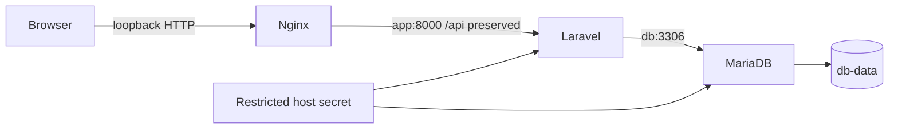

# Laravel React MariaDB Example

Design and explain a complete local Laravel, React, nginx, and MariaDB model with explicit prerequisites.

> [!info] Documentation-only module
> Official references were checked on 2026-10-21. No Docker command, installation, application build, workflow, or deployment was executed. Expected outputs are illustrative. Complete runnable examples and intentionally incorrect fragments are labeled separately.

## Learning objectives

Design and explain a complete local Laravel, React, nginx, and MariaDB model with explicit prerequisites.

## Questions answered

- How can I combine a PHP backend, compiled frontend, and persistent database?

## Prerequisites and execution context

Examples use Ubuntu Linux and Bash with Docker Engine, BuildKit, and the Compose v2 plugin (docker compose). No installation is performed by these notes. Use WSL2 Ubuntu for Bash on Windows; these are not PowerShell commands. Docker Desktop users on macOS must account for Linux VM paths, permissions, and architecture. Readable image tags here are not immutable release pins; review supported versions and use recorded digests for release reproducibility.

Read first: [[08 - Dockerfile and Compose Mastery/08 - Multi-stage Builds|Multi-stage Builds]], [[08 - Dockerfile and Compose Mastery/13 - Compose Build and Dockerfile Integration|Compose Build and Dockerfile Integration]], [[08 - Dockerfile and Compose Mastery/14 - Compose Ports and Networks|Compose Ports and Networks]], [[08 - Dockerfile and Compose Mastery/15 - Compose Volumes and Bind Mounts|Compose Volumes and Bind Mounts]], [[08 - Dockerfile and Compose Mastery/16 - Compose Environment Variables|Compose Environment Variables]], [[08 - Dockerfile and Compose Mastery/17 - Compose Depends On and Healthchecks|Compose Depends On and Healthchecks]], [[08 - Dockerfile and Compose Mastery/18 - Compose Commands and Entrypoints|Compose Commands and Entrypoints]], [[08 - Dockerfile and Compose Mastery/23 - Dockerfile and Compose Together|Dockerfile and Compose Together]], [[08 - Dockerfile and Compose Mastery/27 - Security and Secrets|Security and Secrets]].

Unless identified as a reference fragment, illustrated files belong in a new disposable lab directory when you choose to practice. This vault stores those files only as Markdown examples. Existing-application exercises name their additional prerequisites explicitly.

## Explanation

This development lab combines existing application checkouts rather than inventing project code. Prerequisites: a Laravel project compatible with PHP 8.4 and its required extensions, composer.lock and .env.example; a React TypeScript/Vite project compatible with Node 22, package-lock.json, typecheck/build scripts producing dist, and a frontend API base of /api. The backend must actually provide the API routes the frontend calls. The note cannot infer your authentication, CORS, sessions, uploads, or real application endpoints.

The browser reaches nginx on local loopback. nginx serves built assets and forwards /api requests to the app service. The proxy_pass has no trailing URI slash, so /api/... is preserved. Artisan serves development HTTP; PHP-FPM would instead require a FastCGI web tier. Laravel reaches db:3306 through Compose network DNS. No database port is host-published.

MariaDB reads password files through its image-supported _FILE variables. Laravel does not universally support DB_PASSWORD_FILE: the explicit wrapper reads the mounted file and exports DB_PASSWORD before invoking the official PHP entrypoint. The secret therefore enters the process environment inside the container; this reduces image/config inclusion but is not immunity from a compromised process. Host-file secrets remain host files, not an encrypted vault.

The app uses your exported Linux UID/GID to write vendor and Laravel cache/storage into the disposable bind-mounted checkout. This requires appropriate ownership and a non-sensitive .env.example. frontend is a built snapshot, not Vite HMR; rebuild it after source changes. The app source is bind-mounted for local editing. The nginx runtime retains its image-default privilege model in this lab; production hardening is a separate task.

## Syntax reference

Build contexts: backend and frontend separately. Runtime names: app, frontend, db. Data: db-data at /var/lib/mysql. Secret sources: local restricted files; grants are service-specific. Only frontend port 80 is published as host loopback 8080.

## Code examples

**Required scratch layout (existing projects, not generated applications):**
```text
lab/
  compose.yml
  backend/          # Existing Laravel project plus files below
    Dockerfile
    with-db-secret.sh
    .dockerignore
  frontend/         # Existing Vite React TypeScript project plus files below
    Dockerfile
    nginx.conf
    .dockerignore
  secrets/          # Local untracked files created only if you later practice
```

**backend/Dockerfile:**
```dockerfile
FROM php:8.4-cli
RUN apt-get update \
    && apt-get install -y --no-install-recommends git unzip \
    && rm -rf /var/lib/apt/lists/*
RUN docker-php-ext-install pdo_mysql
COPY --from=composer:2 /usr/bin/composer /usr/local/bin/composer
COPY --chmod=0555 with-db-secret.sh /usr/local/bin/with-db-secret
WORKDIR /app
ENV COMPOSER_HOME=/tmp/composer
USER 10001:10001
ENTRYPOINT ["/usr/local/bin/with-db-secret"]
CMD ["php", "artisan", "serve", "--host=0.0.0.0", "--port=8000"]
```

**backend/with-db-secret.sh (LF line endings):**
```bash
#!/bin/sh
set -eu
DB_PASSWORD="$(cat /run/secrets/db_password)"
export DB_PASSWORD
exec docker-php-entrypoint "$@"
```

**frontend/Dockerfile:**
```dockerfile
FROM node:22-bookworm-slim AS assets
WORKDIR /src
COPY package.json package-lock.json ./
RUN npm ci
COPY . .
RUN npm run typecheck && npm run build
FROM nginx:stable-alpine
COPY --from=assets /src/dist/ /usr/share/nginx/html/
COPY nginx.conf /etc/nginx/conf.d/default.conf
EXPOSE 80
```

**frontend/nginx.conf:**
```nginx
server {
    listen 80;
    server_name _;
    root /usr/share/nginx/html;
    index index.html;

    location /api/ {
        proxy_pass http://app:8000;
        proxy_set_header Host $host;
        proxy_set_header X-Forwarded-For $proxy_add_x_forwarded_for;
    }

    location / {
        try_files $uri $uri/ /index.html;
    }
}
```

**compose.yml at lab root:**
```yaml
name: mastery-fullstack
services:
  app:
    build:
      context: ./backend
      dockerfile: Dockerfile
    user: "${LAB_UID:?Set LAB_UID}:${LAB_GID:?Set LAB_GID}"
    init: true
    volumes:
      - ./backend:/app
    environment:
      APP_ENV: local
      APP_DEBUG: "true"
      DB_CONNECTION: mysql
      DB_HOST: db
      DB_PORT: "3306"
      DB_DATABASE: lesson
      DB_USERNAME: lesson
    secrets: [db_password]
    depends_on:
      db:
        condition: service_healthy
  frontend:
    build:
      context: ./frontend
      dockerfile: Dockerfile
    ports:
      - "127.0.0.1:8080:80"
    depends_on:
      app:
        condition: service_started
  db:
    image: mariadb:11.4
    environment:
      MARIADB_DATABASE: lesson
      MARIADB_USER: lesson
      MARIADB_PASSWORD_FILE: /run/secrets/db_password
      MARIADB_ROOT_PASSWORD_FILE: /run/secrets/db_root_password
    secrets: [db_password, db_root_password]
    volumes:
      - db-data:/var/lib/mysql
    healthcheck:
      test: ["CMD", "healthcheck.sh", "--connect", "--innodb_initialized"]
      interval: 5s
      timeout: 3s
      retries: 20
      start_period: 30s
volumes:
  db-data: {}
secrets:
  db_password:
    file: ./secrets/db_password.txt
  db_root_password:
    file: ./secrets/db_root_password.txt
```

**backend/.dockerignore:**
```text
.git
.env
.env.*
!.env.example
vendor
storage/logs/*
```

**frontend/.dockerignore:**
```text
.git
.env
.env.*
node_modules
dist
```

**Optional local preparation and startup, Ubuntu Bash at lab root:**

These commands create restricted local secret files, install project dependencies inside the mounted disposable checkout, generate its APP_KEY, and migrate the disposable lesson database. Secret-file redirection overwrites existing files: use a new lab directory and do not overwrite credentials for an initialized database. No actual values are included in this note. Do not use production credentials or data. Protect secrets/ and backend/.env from Git; ignore rules for Git and Docker are separate.
```bash
export LAB_UID="$(id -u)"
export LAB_GID="$(id -g)"
umask 077
mkdir -p secrets
read -r -s -p "Disposable app DB password: " LAB_DB_PASSWORD
printf '\n'
printf '%s' "$LAB_DB_PASSWORD" > secrets/db_password.txt
unset LAB_DB_PASSWORD
read -r -s -p "Different disposable root DB password: " LAB_ROOT_PASSWORD
printf '\n'
printf '%s' "$LAB_ROOT_PASSWORD" > secrets/db_root_password.txt
unset LAB_ROOT_PASSWORD
docker compose -f compose.yml config --quiet
docker compose -f compose.yml build
test -f backend/.env || cp backend/.env.example backend/.env
docker compose -f compose.yml run --rm --no-deps app composer install --no-interaction
docker compose -f compose.yml run --rm --no-deps app php artisan key:generate
docker compose -f compose.yml up -d --wait --wait-timeout 180 db
docker compose -f compose.yml run --rm --no-deps app php artisan migrate
docker compose -f compose.yml up -d app frontend
curl --fail --silent --show-error http://127.0.0.1:8080/ -o /dev/null
```


## Line-by-line walkthrough

1. Create a new lab root and copy disposable existing projects into backend and frontend. Save the illustrated files only when intentionally trying the exercise; no actual application is created by this note.

2. The backend recipe prepares required tools as root, adds pdo_mysql, copies Composer and the wrapper, then defaults to a non-root process. Review additional extensions from your actual lock file.

3. The wrapper reads the runtime password, exports it, and execs docker-php-entrypoint with the original arguments so command overrides such as Composer or Artisan still work.

4. The frontend stage typechecks and builds locked source; nginx receives dist and a deliberate SPA/API routing configuration. Browser requests never contain database credentials.

5. Compose uses Linux host UID/GID for bind-mount ownership. Service environment supplies DB_HOST=db and non-secret lab database names; the secret grants supply actual passwords.

6. The interactive setup writes two different local secrets with restrictive umask. It does not print them. Existing initialized volumes retain old account credentials, so do not regenerate secret files against valuable persisted state casually.

7. config --quiet resolves the model without echoing the secret values. build constructs both images; the backend runtime does not include source, so the development bind mount is required.

8. Copy the environment template only when missing. Install Composer packages, generate only this disposable application key, start and wait for db, and apply migrations only to the lesson database.

9. Start app and frontend. service_started orders them but does not prove API readiness; the first request can race app startup. Inspect logs and add an application-specific health check when automating.

10. The curl checks the static root only. Verify a real known API route separately and compare its actual expected response. Do not claim authentication or database integration works from a static page alone.

## DO ✅ / DON'T ❌

- **DO ✅** Keep browser, app and database address scopes separate, because each resolves different names.
- **DO ✅** Inspect your project’s lock files and routes, because a generic container lab cannot establish project compatibility.
- **DO ✅** Keep the database volume and app key stable for continued lab data, because changing secrets/config can break existing state.

- **DON'T ❌** Treat this as a production-ready deployment, because Artisan, debug mode, local files and host source mounts are development decisions.
- **DON'T ❌** Put database credentials into frontend build variables, because they become public browser assets.
- **DON'T ❌** Reset a database volume to repair a credential mismatch unless you explicitly intend to destroy its data.

## Expected result

Your plan explains each file, service, variable, mount, port and secret grant; if later run, verify both a static page and an actual application API response. This is an expected result, not an execution claim.

## Common errors and troubleshooting

Missing vendor: Composer must install into the bind-mounted backend. Permission denied: export correct UID/GID and inspect actual host ownership. Secret read denied: the app UID must read the protected host-backed file. SQL access denied after changing files: existing volume credentials were initialized earlier. API 502: app may not be ready; inspect logs and its HTTP listener. API 404: confirm nginx preserved /api and your Laravel project actually defines that route. Root page success proves static hosting only.

## Practice exercise

**Problem and objective:** Draw every file input and request hop, then adapt a disposable real application to this layout.

**Success condition:** Your plan explains each file, service, variable, mount, port and secret grant; if later run, verify both a static page and an actual application API response.

**Hint:** First prove PHP-to-db connectivity, then proxy routing, then frontend behavior; do not debug all boundaries simultaneously.

## Knowledge check

1. Where does React execute?
2. Can Laravel assume DB_PASSWORD_FILE works automatically?
3. Does service_started prove API readiness?
4. What persists database data?
5. Does a successful static curl prove the backend works?

> [!question]- Answers
> 1. In the browser after static assets are served.
> 2. No; this lab provides an explicit wrapper.
> 3. No.
> 4. The named db-data volume.
> 5. No.

## Request and storage diagram



## Additional official references

- [Laravel deployment/runtime requirements](https://laravel.com/docs/13.x/deployment)
- [MariaDB image initialization variables](https://mariadb.com/docs/server/server-management/automated-mariadb-deployment-and-administration/docker-and-mariadb/mariadb-server-docker-official-image-environment-variables)


## Cleanup

For this disposable lab, docker compose -f compose.yml down stops/removes containers and the default network while keeping db-data. This leaves dependency files, backend/.env, secret files, images and persistent data. Adding --volumes permanently erases the database; do so only after confirming the lab data is expendable. Remove local secrets and generated project files only within this disposable copy. Do not rotate a real Laravel APP_KEY or delete production volumes as cleanup.

## Related lessons

- [[08 - Dockerfile and Compose Mastery/00 - Mastery Roadmap|Mastery Roadmap]]
- [[Docker/Docker Index|Docker learning path]]
- [[Docker/Docker Questions|Docker learner questions]]
- [[08 - Dockerfile and Compose Mastery/08 - Multi-stage Builds|Multi-stage Builds]]
- [[08 - Dockerfile and Compose Mastery/13 - Compose Build and Dockerfile Integration|Compose Build and Dockerfile Integration]]
- [[08 - Dockerfile and Compose Mastery/14 - Compose Ports and Networks|Compose Ports and Networks]]
- [[08 - Dockerfile and Compose Mastery/15 - Compose Volumes and Bind Mounts|Compose Volumes and Bind Mounts]]
- [[08 - Dockerfile and Compose Mastery/16 - Compose Environment Variables|Compose Environment Variables]]
- [[08 - Dockerfile and Compose Mastery/17 - Compose Depends On and Healthchecks|Compose Depends On and Healthchecks]]
- [[08 - Dockerfile and Compose Mastery/18 - Compose Commands and Entrypoints|Compose Commands and Entrypoints]]
- [[08 - Dockerfile and Compose Mastery/23 - Dockerfile and Compose Together|Dockerfile and Compose Together]]
- [[08 - Dockerfile and Compose Mastery/27 - Security and Secrets|Security and Secrets]]
- [[08 - Dockerfile and Compose Mastery/25 - Development vs Production|Development vs Production]]

## Official references

- [Build documentation](https://docs.docker.com/reference/compose-file/build/)
- [Services documentation](https://docs.docker.com/reference/compose-file/services/)
- [Secrets documentation](https://docs.docker.com/reference/compose-file/secrets/)
- [Volume documentation](https://docs.docker.com/reference/compose-file/volumes/)
- [Health documentation](https://docs.docker.com/compose/how-tos/startup-order/)

---

## 📚 Lesson Navigation

| ⬅️ Previous Lesson | Next Lesson ➡️ |
|:------------------|----------------:|
| [[08 - Dockerfile and Compose Mastery/23 - Dockerfile and Compose Together\|Dockerfile and Compose Together]] | [[08 - Dockerfile and Compose Mastery/25 - Development vs Production\|Development vs Production]] |

🏠 [[00 - Learning Roadmap|Back to Learning Roadmap]]
